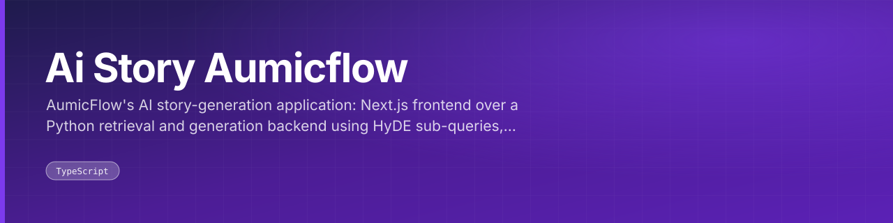
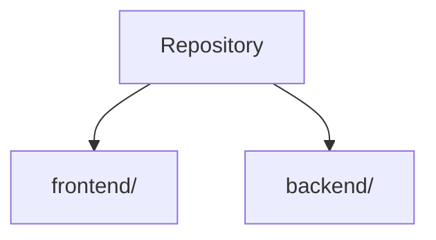

<div align="center">



AumicFlow's AI story-generation application: Next.js frontend over a Python retrieval and generation backend using HyDE sub-queries, intent checks and inspiration-profile prompts.

<br>


 

</div>

---

## What this is

The AumicFlow build of the AI story-generation application, larger than the earlier copy at 185 tracked files. A TypeScript frontend sits over a Python backend whose prompt set drives retrieval and writing: HyDE sub-query expansion, an intent check, inspiration-profile fusion and summarisation, then story generation. Ships with Docker Compose for local runs.

The code is laid out as:

- `frontend/` — frontend
- `backend/` — backend

<div align="center">

|  |  |  |
|:--:|:--:|:--:|
| **14** | **5** | **10** |
| Python modules | model modules | docs |

</div>

---

## Architecture



<sub>Derived from the directories present in this repository.</sub>

---

## Surfaces

**Routes** (4)

|  |  |  |
|---|---|---|
| `/frontend/src/pages/AuthPage` | `/frontend/src/pages/ChatPage` | `/frontend/src/pages/HomePage` |
| `/frontend/src/pages/NotFoundPage` |  |  |

---

## Getting started

Configuration comes from the environment. Copy the checked-in template and fill in your own values:

```bash
cp backend/.env.example .env.local
```

---

## Project structure

| Path | Contents | Files |
|---|---|---|
| `frontend/` | frontend | 63 |
| `backend/` | backend | 48 |

<sub>185 tracked files in total.</sub>

---

<div align="center">
<sub><a href="https://github.com/cubixso-organisation/ai-story-aumicflow">cubixso-organisation/ai-story-aumicflow</a></sub>
</div>

## Setup notes for this public copy

- **Knowledge base:** the story corpus and its FAISS index are not included. Put your own
  `.pdf`/`.txt` stories in `backend/knowledge/` and run the indexer
  (`backend/retrieval/embed_index.py`) to build `backend/data_index/faiss_index/`.
- **Speech model:** download the Vosk model `vosk-model-small-en-us-0.15` from
  https://alphacephei.com/vosk/models and unzip it into `backend/models/`.
- **Secrets:** copy `backend/.env.example` to `backend/.env` and fill in your own keys.
